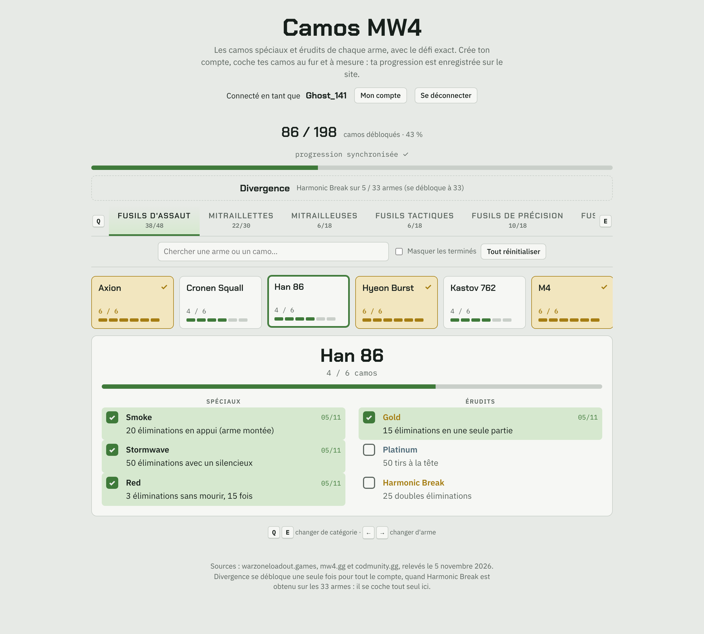
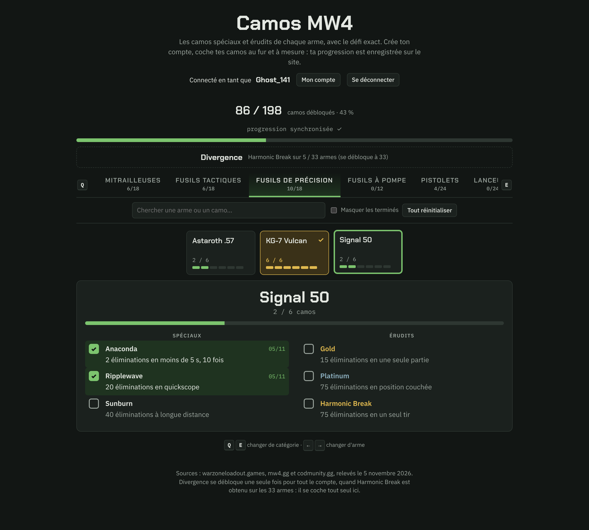
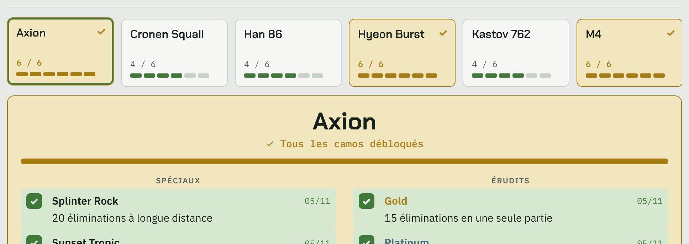
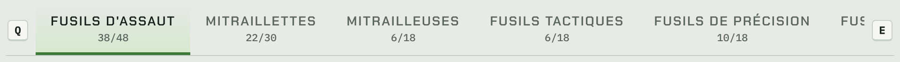
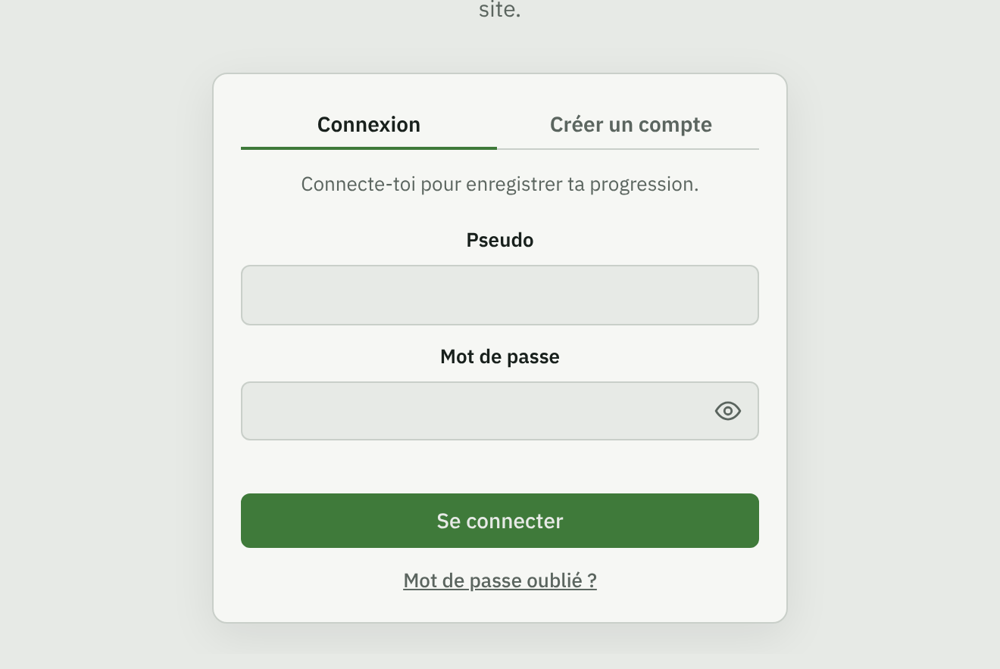
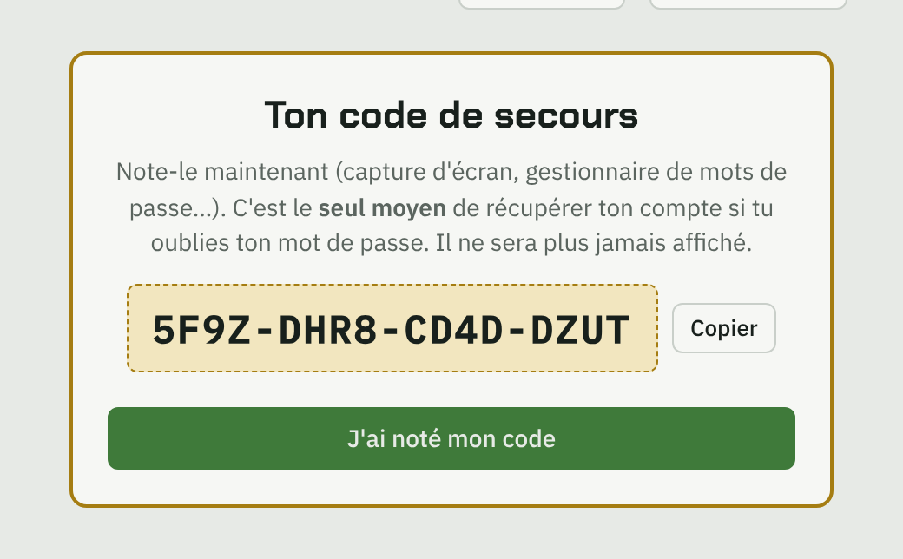
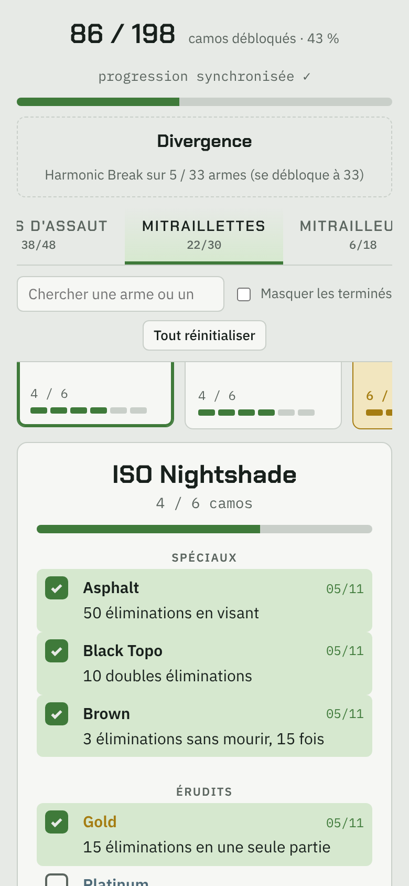

# Camos MW4 – tracker multijoueur




Site web pour suivre sa progression sur les camouflages de **Call of Duty: Modern Warfare 4**.
Chaque joueur crée un compte, coche ses camos au fur et à mesure et retrouve sa progression
depuis n'importe quel appareil.

## Fonctionnalités

- **33 armes, 198 camos** : les 3 camos spéciaux et les 3 camos érudits (Gold, Platinum,
  Harmonic Break) de chaque arme, avec le défi exact en français.
- **Interface en volets** inspirée des menus de Call of Duty : onglets de catégories,
  rangée d'armes, panneau de camos. Raccourcis clavier `Q` / `E` (catégories) et `←` / `→` (armes).
- **Retour visuel immédiat** : case animée, ligne verte, date de déblocage, arme qui passe
  en doré une fois complète, compteurs par arme, par catégorie et au total.
- **Divergence** calculé automatiquement (Harmonic Break sur les 33 armes).
- **Comptes joueurs** : inscription, connexion, changement de mot de passe.
- **Mot de passe oublié sans e-mail** : code de secours à usage unique remis à l'inscription.
- Recherche dans toutes les armes et tous les camos, filtre « masquer les terminés »,
  responsive mobile, thème clair et sombre automatique.

## Captures

<table>
<tr>
<td width="50%"><br><sub><b>Thème sombre</b> automatique, selon le réglage de l'appareil.</sub></td>
<td width="50%"><br><sub><b>Arme terminée</b> : la carte et le panneau passent en doré.</sub></td>
</tr>
<tr>
<td colspan="2"><br><sub><b>Volets façon Call of Duty</b> : une catégorie par onglet, compteur sous chaque nom, navigation avec <code>Q</code> / <code>E</code>.</sub></td>
</tr>
<tr>
<td width="50%"><br><sub><b>Connexion</b> centrée, avec affichage du mot de passe et lien « mot de passe oublié ».</sub></td>
<td width="50%"><br><sub><b>Code de secours</b> remis à l'inscription pour récupérer son compte sans e-mail.</sub></td>
</tr>
</table>

<p align="center"><br><sub><b>Version mobile</b> : catégories et armes défilent au doigt.</sub></p>

## Stack

- **Front** : HTML, CSS et JavaScript natifs, sans framework ni dépendance.
- **Back** : PHP 8.1+ (une seule API JSON, `api.php`).
- **Base** : SQLite via PDO, créée automatiquement au premier compte.

## Sécurité

| Mesure | Protège contre |
|---|---|
| `password_hash` (bcrypt) pour les mots de passe et les codes de secours | fuite de la base |
| Requêtes préparées PDO | injection SQL |
| Jeton anti-CSRF + vérification de l'en-tête `Origin` | requêtes forgées depuis un autre site |
| Cookie `HttpOnly`, `Secure`, `SameSite=Strict`, préfixe `__Host-`, `use_strict_mode` | vol et fixation de session |
| Version de compte : changer de mot de passe déconnecte les autres sessions | session volée qui reste active |
| Limitation des échecs par IP et par pseudo, limite d'inscriptions par IP | force brute, spam de comptes |
| Réponse identique et temps constant pour un pseudo inconnu | énumération des comptes |
| Content-Security-Policy stricte (aucun script inline), HSTS, `X-Frame-Options` | XSS, clickjacking |
| Base hors du dossier web, `.htaccess` sur les fichiers sensibles | téléchargement de fichiers internes |

## Installation

1. Copier le contenu du dépôt dans le dossier web d'un hébergement PHP 8.1+ avec `pdo_sqlite`.
2. Ouvrir le site et créer un compte : la base `camos.db` est créée dans un dossier
   `camos-data/` à côté du dossier web (modifiable dans `config.php`).
3. En local : `php -S localhost:8765` dans le dossier, ou `LANCER-EN-LOCAL.bat` sous Windows.

Le guide de mise en ligne détaillé (alwaysdata, HTTPS, sauvegardes) est dans [`LISEZMOI.md`](LISEZMOI.md).

## Structure

```
index.html            page du tracker
assets/app.js         interface (volets, comptes, sauvegarde)
assets/style.css      styles
assets/camos-data.js  données des armes et des camos
docs/screenshots/     captures du README
api.php               API : comptes, progression, récupération
config.php            emplacement de la base, limites anti-abus
schema.sql            tables utilisateurs, progression, evenements
.htaccess             en-têtes de sécurité et fichiers bloqués
```

## Sources des données

Défis relevés sur warzoneloadout.games, mw4.gg et codmunity.gg (novembre 2026), complétés en jeu.
Projet non affilié à Activision ni à Call of Duty.

---

Projet personnel de Boris M., étudiant en BUT MMI à Haguenau.
